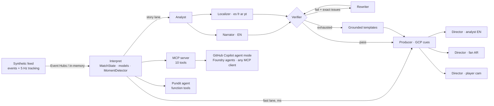

# REGISTA · the multi-agent match director

> *Regista* (Italian): the deep-lying playmaker who orchestrates a team, and the director who calls the shots in a TV gallery.

**One synthetic match feed in. A different, explainable, verified broadcast out for every fan.**

Regista turns synthetic football events and 5 Hz tracking into match intelligence that explains *why* moments matter, renders it as timed broadcast graphics, and re-cuts the whole broadcast per viewer: an analyst in English, a Port Calder fan in Arabic, a newcomer in Spanish and a player-cam viewer following one midfielder, all from the same feed at the same time.

It is built on **Microsoft Agent Framework** (agents + workflow), runs models on **Microsoft Foundry**, ingests through **Azure Event Hubs**, ships as one container on **Azure Container Apps**, traces to **Application Insights**, and exposes the live match to **GitHub Copilot agent mode** and any agent over **MCP**.

| | |
|---|---|
|  |  |
| **Broadcast**: tracked players, name tags, a pass-quality card, and an on-air receipt with provenance and evidence id | **Two fans, two broadcasts**: an English analyst and an Arabic, right-to-left Port Calder fan watch the same second |
|  |  |
| **Control room**: the live agent graph, the chaos switch, the circuit breaker, spans and Director decisions | **Data lab**: realism vs top-flight ranges, and explainers scored against ground truth |

---

## Why it stands out

1. **Receipts on every claim.** Every on-screen sentence carries the evidence event ids behind it. A deterministic **Verifier** checks every figure and every player name against the computed facts before anything airs. If a draft fails, it goes back to the Narrator with the exact issues, and after two failures a grounded template airs instead. Template copy verifies at **283/283 moments × 5 languages × 3 personas**.
2. **Two lanes, never dark.** A deterministic *fast lane* puts shot cards, pass-quality cards, player tags and speed flashes on screen within milliseconds of the event. A generative *story lane* (Analyst → Narrator → Localizer → Verifier) upgrades the copy **in place** once it passes verification. Pull the plug on the model (Control Room → *Simulate model outage*) and the breaker trips, templates take over, and viewers see no gap.
3. **Explanations you can grade.** Real feeds never tell you *why* a team changed shape, so nobody can check whether an "explainable AI" is right. Our simulator logs what it actually did (true xG per shot, the minute a team switched its press). Regista detects tactical shifts **from tracking alone**: players within 8 m of the ball in the opponent's build-up, and defensive line height. It is then scored against that ground truth. Few entries will be able to measure their explanations at all.
4. **A broadcast contract, not a chat box.** The output is the **Graphics Cue Protocol (GCP v1)**: versioned, machine-readable cues timed on the match clock, with slot, priority, locale, audience, evidence and provenance. They can drive any renderer. The same cues drive our web overlay and a **transparent overlay page for OBS / vMix / CasparCG** (`/#/overlay?mode=analyst&lang=es`).
5. **Personalisation that changes the broadcast, not just the language.** The **Director** scores every cue per viewer: mode, favourite club, favourite player and focus metric. It enforces a cue budget and screen-slot scheduling, picks the language and voice, and writes partisan captions ("GET IN! Valdane" for one fan, "Northbridge score · 1-0" for the other). Player cam pins a live stats card and a halo to one player for the whole match.

## The pipeline: one feed, five stages

| Stage | What Regista does | Where |
|---|---|---|
| **Ingest** | Seeded, tactically-aware simulator: possession chains, physics-limited 5 Hz tracking for 22 players, set pieces, cards, subs, scripted tactical scenarios and a hidden ground-truth log. Published through an event bus (in-memory or **Azure Event Hubs**). | `sim/`, `runtime/bus.py` |
| **Interpret** | A live blackboard of team and player state. Interpretable models with named factors: location xG, a 0–100 **pass difficulty** rating, opponents bypassed per pass, Poisson **win probability**, momentum, a **control-vs-chaos index** scored against the league reference, a press-shift detector (z-test plus change-point onset), and game-rhythm classes. | `intel/` |
| **Explain** | Agent Framework workflow: **Analyst** (why it matters), **Narrator** (3 personas), **Localizer** (es/fr/ar/pt idiom), **Verifier** (grounding + brand safety, retry loop), **Recap** (match report), **Pundit** (Q&A with function tools). | `agents/` |
| **Render** | **Producer** emits GCP cues; the web app renders them over a broadcast-angle pitch (or a tactical cam with a tactical lens showing line heights and the pressing radius). | `agents/producer.py`, `web/` |
| **Personalise** | One **Director** per viewer: relevance, budget, slots, language, persona, partisan captions, player cam. | `agents/director.py` |



## The agents

| Agent | Kind | Job | When it fails |
|---|---|---|---|
| Interpret (Scout) | deterministic | events + tracking → state, enriched events, moments with `why` factors and evidence | n/a (pure computation) |
| **Analyst** | LLM (`agent_framework.Agent`) | why the moment matters: claim, reasons, tactical read, key numbers; called only for goals, red cards, press shifts and big chances (routine moments use their factor breakdown, saving a model round trip) | deterministic insight from the moment's factors |
| **Narrator** | LLM | caption / line / explainer × casual, analyst, new fan | retry with the Verifier's issues, then template |
| **Localizer** | LLM | native es / fr / ar / pt copy, written in parallel with the Narrator from the same insight (no translation) | per-language rewrite, then template |
| **Verifier** | deterministic | every figure grounded within rounding (incl. the moment's minute and its players' shirt numbers), only allowed players named, football claims (header, penalty, free kick) match the facts, slot length limits, brand safety | n/a (it is the guard) |
| **Producer** | deterministic | GCP cues: kind, slot, timing, priority, provenance | n/a |
| **Director** ×N | deterministic policy | per-viewer relevance, budget, slot scheduling, language, persona, partisan copy | n/a |
| **Recap** | LLM | half-time / full-time report with evidence ids per turning point | verified template recap |
| **Pundit** | LLM + function tools | fan Q&A in five languages, tool calls cited | multilingual intent router over the same tools |

Reliability: per-call timeout, a circuit breaker (opens after 3 consecutive failures and half-opens to probe), fault injection for live demos, OpenTelemetry spans to Application Insights, and a span stream to the Control Room.

## Evidence

| Measure | Result |
|---|---|
| Realism (20 matches, per team, per match, vs top-flight reference ranges) | **14/14 metrics inside**: 615 passes at 80%, 15.3 shots, 1.50 xG, 1.55 goals, 0.097 xG/shot, 12.0 km per outfield player, 32 km/h median top speed |
| Live xG model vs engine's true scoring probability (607 shots) | bias **−0.007**, MAE **0.009** per shot |
| Press-shift detection from tracking (33 true shifts, 20 matches) | recall **52%**, **0.6** false alarms per match, median detection delay **5 min**, median onset error **2 min** |
| Generated-copy grounding (offline templates, 283 moments × 5 languages × 3 personas) | **100%** of figures supported by facts |
| Real model: Microsoft Foundry `gpt-4.1-mini`, 12 story moments × English, Spanish, Arabic (`regista llm-eval`) | **100%** of moments air model-written, verified copy (0 template fallbacks); **83%** of first drafts pass the fact-check untouched; story lane p50 **5.0 s**, p95 8.1 s; the Pundit called its tools for 100% of questions in 4 languages; English and Arabic recaps verified |
| Self-correction loop | a test model that invents a figure and an uninvolved player is rejected by the Verifier, receives the exact issues, and fixes its draft on retry; a model that never listens ends in the grounded fallback |
| Tests | 24 end-to-end and unit tests, all offline, ~25 s, covering the live feed API, on-air JSON, webhooks, guards, the agent loop, football-claim checks and the pipeline |

Reproduce: `regista realism --matches 20` and `regista evaluate --matches 20` (results land in `docs/`; the Data lab page renders them).

## Microsoft and GitHub stack

| Technology | How Regista uses it |
|---|---|
| **Microsoft Agent Framework** | `Agent`s with distinct instructions, a `WorkflowBuilder` graph with switch-case retry edges, `@tool` function tools for the Pundit, a custom `BaseChatClient` for offline runs, and OpenTelemetry instrumentation |
| **Microsoft Foundry** | Foundry project + `gpt-4.1-mini` deployment (Bicep), `FoundryChatClient` with Entra ID / managed identity, no keys |
| **Azure Container Apps** | one container serves API, WebSocket, MCP and the web app; managed identity pulls from ACR |
| **Azure Event Hubs** | the ingest stage: every feed event is published to `match-events`, with a `fabric-rti` consumer group for Fabric Real-Time Intelligence |
| **Application Insights** | agent runs, chat calls, tool calls and workflow supersteps via Azure Monitor OpenTelemetry |
| **MCP** | 10 live-match tools + a match resource at `/mcp` (streamable HTTP) |
| **GitHub Copilot agent mode** | `.vscode/mcp.json` + a custom `match-analyst` agent (`.github/agents`) + repo instructions |
| **GitHub Actions** | CI runs lint, tests, the ground-truth evaluation, the web build and the image build |
| **Azure Developer CLI** | `azd up` provisions everything above from `infra/` |

## Use it for real, not just as a demo

Regista plugs into an actual production chain, with no simulator required. Full guide: [docs/real-world.md](docs/real-world.md).
- **Live feed API:** any data provider pushes events and 5 Hz tracking to `POST /api/feed`. Ingestion is idempotent and
  validated against JSON Schema, and `regista publish` is a working reference provider.
- **Your own graphics:** `GET /api/onair?mode=casual&lang=ar&team=CAL` returns what that viewer should see right now as
  one flat JSON row. Bind it to vMix Data Sources or CasparCG templates, or add `/#/overlay` as an OBS browser source.
- **Media teams and fan communities:** webhooks post verified goals, red cards, tactical shifts and recaps to Slack,
  Teams or Discord in five languages.
- **Safe in public:** an optional producer token for shared controls, rate-limited Q&A, chaos that switches itself
  off, and a demo that loops itself for judges.

## Run it

**Offline, no keys, about 2 minutes:**

```bash
cd backend && uv venv --python 3.12 && uv pip install -e ".[dev]" && .venv/bin/regista serve
```

```bash
cd web && npm install && npm run dev
```

Open http://localhost:5173, press **Play** (4× is good for watching; 30× to skim) and try:
- Fan Studio presets: *Analyst · EN*, *Port Calder fan · عربي*, *New to football · ES*, *Player cam · Arata*
- **Two fans** for side-by-side broadcasts
- **Control room** → *Simulate model outage*
- Click any key moment to see its **receipts** (factors, agent trace, verifier verdict, copy in every language)
- **Ask the Pundit**: "Why are Northbridge winning the ball so high?"

**With real models:** set `REGISTA_LLM=foundry` with `FOUNDRY_PROJECT_ENDPOINT` + `FOUNDRY_MODEL` (Entra ID, e.g. after `az login`), or `REGISTA_LLM=azure_openai` / `openai`. See `.env.example`. `regista llm-eval` then scores the live agents: first-draft verification rate, retries, fallbacks and latency.

**On Azure:** `azd up` (Foundry project and model, Container Apps, Event Hubs, Application Insights, ACR, managed identity and roles).

**From GitHub Copilot:** start the API, open the repo in VS Code, enable the `regista` MCP server, pick the **match-analyst** agent and ask about the live match.

**Docker:** `docker build -t regista . && docker run -p 8000:8000 regista` then open http://localhost:8000.

## Repository map

```
backend/regista/
  sim/        engine (possession chains + 5 Hz tracking), fictional squads, scenarios, realism report
  intel/      MatchState blackboard, interpretable models, windowed signals, moment detector
  agents/     Agent Framework agents + story workflow, verifier, producer, director, pundit, recap, templates (5 languages)
  runtime/    live session (fast + story lanes), event bus (Event Hubs), observability
  api/        FastAPI REST + WebSocket;  mcp_server.py  MCP tools;  evaluation.py  ground-truth scoring;  cli.py
web/src/      pitch renderer (broadcast + tactical cams), GCP overlay, Fan Studio, Pundit, Control Room, Recap, Data lab
infra/        Bicep for azd: Foundry, Container Apps, Event Hubs, App Insights, ACR, managed identity
docs/         demo script, submission text, Fabric RTI notes, evaluation + realism outputs
```

## Responsible by design
- **Synthetic only.** Every club, player, venue and referee is invented, with no real crests, trademarks or footage. Feeds are reproducible from a seed.
- **Grounded and auditable.** Numbers come from deterministic models with named factors; language models only explain them. Every cue carries evidence ids and provenance (agent, model, verified, fallback, drafts, latency).
- **Brand-safe.** The Verifier blocks betting, gambling and alcohol language in all five languages.
- **Accessible.** Right-to-left layout and Arabic typography, a plain-language *new fan* persona that explains jargon, `prefers-reduced-motion` support, and keyboard-reachable controls.

## Judging criteria map

| Criterion | Where to look |
|---|---|
| Technological implementation | synthetic data with ground truth and a realism report, typed contracts (JSON Schema at `/api/schema/*`), tests and CI, Agent Framework + Foundry + Event Hubs + Container Apps + MCP |
| Agentic design and innovation | Verifier-in-the-loop workflow with targeted retries, two-lane progressive enhancement, per-viewer Director agents, Pundit with function tools, MCP for Copilot |
| Real-world impact | GCP cues and a transparent overlay for production switchers, multilingual by default, chaos-tested reliability, `azd up` deployment |
| User experience | broadcast-grade overlay, Two fans view, Control room, receipts drawer, recap page |
| Category: Best Multi-Agent System | distinct agents, shared state (the StoryJob and MatchState blackboard), hand-offs and loops, failure recovery shown live |

MIT licensed. Built for the Inside the Game developer hackathon.
