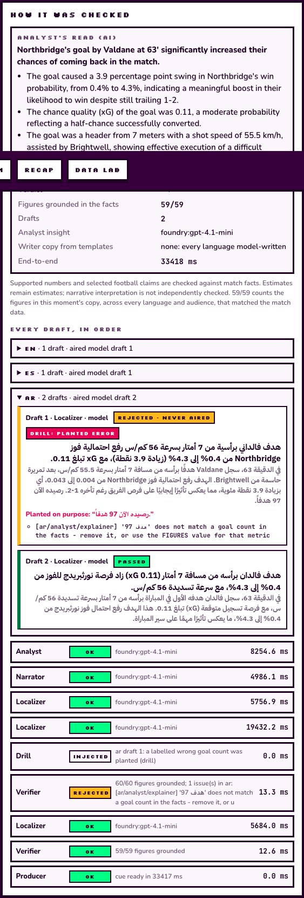
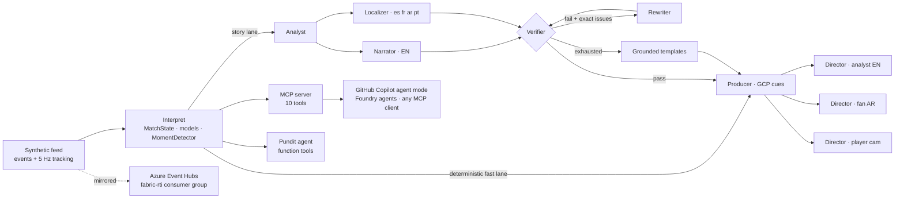

# REGISTA · the multi-agent match director

**Match stories for different fans. Evidence for the producer.**

**Live demo:** https://ca-registaednsnlttycm2o.calmsea-720b2319.koreacentral.azurecontainerapps.io (Microsoft Foundry gpt-4.1-mini on Azure Container Apps; allow time for a cold container to wake)

**Try it in one minute:** [Explore a moment](https://ca-registaednsnlttycm2o.calmsea-720b2319.koreacentral.azurecontainerapps.io/#/explore?moment=highlight) shows Northbridge’s 63rd-minute response, reducing the deficit to 1–2, as three fictional fans get it (an English analyst, an Arabic-speaking supporter of the side that conceded, a Spanish newcomer), with the facts behind it and the Verifier's verdict. Switch to **Same language** to compare Tom and Sam, both reading English.

> *Regista* (Italian): the deep-lying playmaker who orchestrates a team, and the director who calls the shots in a TV gallery.

**One producer, one synthetic match feed, different explanations for different audiences.**

Regista turns synthetic football events and 5 Hz tracking into match intelligence that explains *why* moments matter, renders it as timed broadcast graphics, and re-cuts the whole broadcast per viewer: an analyst in English, a Port Calder fan in Arabic, a newcomer in Spanish and a player-cam viewer following one midfielder, all from the same feed at the same time.

It is built on **Microsoft Agent Framework** (agents + workflow), runs models on **Microsoft Foundry**, publishes every feed event to **Azure Event Hubs** for downstream consumers, ships as one container on **Azure Container Apps**, traces to **Application Insights**, and exposes the live match to **GitHub Copilot agent mode** and any agent over **MCP**.


**Explore a moment**: the same second as three broadcasts, each in its fan's language, with what each fan is shown and why

| | |
|---|---|
|  |  |
| **Broadcast**: Northbridge’s 63rd-minute response with tracked players, name tags, a shot card and a lower third whose figures were checked | **Two fans, two broadcasts**: an English analyst and an Arabic, right-to-left Port Calder fan watch the same second |
|  |  |
| **Receipts**: every fact tagged observed or model estimate, the Verifier's verdict and the agent trace | **Data lab**: inspect saved evaluation reports and their scope; historical results are not current-build measurements |
|  |  |
| **Control room**: the real agent workflow live, the chaos switch, the circuit breaker, spans and Director decisions | **Recap**: a match report with checked supported figures and evidence, plus the win-probability path |
|  |  |
| **Correction receipt**: in a labelled drill a wrong goal count planted in the Arabic draft is rejected with the Verifier's exact findings and never airs; only Arabic is rewritten | **Overlay export**: Amira's Arabic browser overlay, right to left, from the Control room's export links; external switcher use requires validation |

The screenshots were refreshed on 22 October from the corrected local build with Microsoft Foundry and synthetic data. [Capture provenance](docs/img/capture-manifest.json) records the displayed goal, model sources and actual correction verdicts. Publishing this build and recording the required video remain release tasks.

---

## Why it stands out

1. **Inspectable checks and correction receipts.** Every cue carries the evidence event ids behind it. Before generated copy airs, a deterministic **Verifier** checks it against match data only (never against anything a model produced): supported numeric forms, including ordinals, small counts and written-out numbers in five languages; figures with a unit (km/h, metres, %, goals, players, per-minute rates, the match minute) against facts of that kind, so a 33 km/h sprint cannot become "33 goals" and a rate per 100 passes cannot become "per minute"; a goal count next to the scorer's name against that player's tally, and "down to ten" against the players actually left; the squad players it names; and selected football claims (header, penalty, free kick, brace, hat-trick). Writers are told each metric's unit. A failing draft goes back to its writer with the exact issues; after two failures a grounded template airs instead, and unverified copy never replaces the on-air graphic. What it does not check: causal claims, tone, invented names from outside the squad, and a count attached by a pronoun in a later sentence. "Verified" means the copy passed these checks, not that every statement is independently true.
2. **Essential graphics first, generated explanations later.** Deterministic shot cards, pass-quality cards, player tags and templates can appear without waiting for a model. The story workflow upgrades eligible cues after its checks. Its timeout, bounded retries and fallback behavior can be exercised through the labelled recovery drill or Control room outage simulation. Model upgrades take additional time; healthy language results currently wait for the whole workflow to finish.
3. **Explanations that can be tested.** The simulator logs shot probabilities and tactical changes. Detection uses the observed tracking stream; evaluation compares its results with the hidden synthetic ground truth. This supports reproducible tests of the prototype, not a claim of accuracy on real football.
4. **Timed, inspectable output.** The **Graphics Cue Protocol (GCP v1)** gives each cue a match time, slot, priority, locale, audience, evidence and provenance. The same cues drive the web app and a transparent browser overlay (`/#/overlay?mode=analyst&lang=es`). `/api/onair` exposes structured output for a compatible graphics integration.
5. **Audience choices beyond language.** The **Director** scores cues for a viewer's knowledge level, favourite club, favourite player and focus. It applies a cue budget and slot schedule. Explore's **Same language** view holds English constant while showing an analyst and a newcomer different explanations.

The current seed-16 synthetic demo finishes **Northbridge 1–2 Port Calder**: Port Calder score at **48′** and **50′**; Northbridge respond at **63′**, reducing the deficit to one goal. There are **no red cards** in this match. Use `?moment=highlight` to open that response; event IDs can change when the simulator is corrected. Recovery drills are labelled injected failures, and fictional fan personas are not user-study participants.

## The pipeline: one feed, five stages

| Stage | What Regista does | Where |
|---|---|---|
| **Ingest** | Seeded, tactically-aware simulator: possession chains, physics-limited 5 Hz tracking for 22 players, set pieces, cards, subs, scripted tactical scenarios and a hidden ground-truth log. Every event is also published to an event bus (in-memory or **Azure Event Hubs**) for downstream consumers; the live pipeline reads the feed directly. | `sim/`, `runtime/bus.py` |
| **Interpret** | A live blackboard of team and player state. Interpretable models with named factors: location xG, a 0–100 **pass difficulty** rating, opponents bypassed per pass, Poisson **win probability**, momentum, a **control-vs-chaos index** scored against the league reference, a press-shift detector (z-test plus change-point onset), and game-rhythm classes. | `intel/` |
| **Explain** | Agent Framework workflow: **Analyst** (why it matters), **Narrator** (3 personas), **Localizer** (es/fr/ar/pt idiom), **Verifier** (grounding + brand safety, retry loop), **Recap** (match report), **Pundit** (Q&A with function tools). | `agents/` |
| **Render** | **Producer** emits GCP cues; the web app renders them over a broadcast-angle pitch (or a tactical cam with a tactical lens showing line heights and the pressing radius). | `agents/producer.py`, `web/` |
| **Personalise** | One **Director** per viewer: relevance, budget, slots, language, persona, partisan captions, player cam. | `agents/director.py` |



## The agents

| Agent | Kind | Job | When it fails |
|---|---|---|---|
| Interpret (Scout) | deterministic | events + tracking → state, enriched events, moments with `why` factors and evidence | n/a (pure computation) |
| **Analyst** | LLM (`agent_framework.Agent`) | why the moment matters: claim, reasons, tactical read, key numbers; called only for goals, red cards, press shifts and big chances (routine moments use their factor breakdown, saving a model round trip) | deterministic insight from the moment's factors |
| **Narrator** | LLM | caption / line / explainer × casual, analyst, new fan | retry with the Verifier's issues, then template |
| **Localizer** | LLM | native es / fr / ar / pt copy, written in parallel with the Narrator from the same insight (no translation) | per-language rewrite, then template |
| **Verifier** | deterministic | evidence is match data only (facts, context, clock, shirt numbers), never model output; supported figures checked within rounding (digits, ordinals, written-out numbers in 5 languages); figures with units matched to facts of that kind; no uninvolved squad players; football claims (header, penalty, free kick) match the facts; slot length limits; brand safety | n/a (it is the guard) |
| **Producer** | deterministic | GCP cues: kind, slot, timing, priority, provenance | n/a |
| **Director** ×N | deterministic policy | per-viewer relevance, budget, slot scheduling, language, persona, partisan copy | n/a |
| **Recap** | LLM | live / half-time / full-time report with evidence ids per turning point | checked template recap |
| **Pundit** | LLM + function tools | fan Q&A in five languages, tool calls cited | multilingual intent router over the same tools |

Reliability: per-call timeout, a circuit breaker (opens after 3 consecutive failures and half-opens to probe), fault injection for live demos, OpenTelemetry spans to Application Insights, and a span stream to the Control Room.

## Evidence and limits

The simulator and model-response handling were corrected on **22 October 2026**. The standard 20-match evaluation and realism reports, 12-match synthetic stress run and fresh Foundry run below were completed after those fixes. Earlier reports are retained in the [history archive](docs/history/before-physics-fix-2026-10-22/); the older fan-out report remains a separate historical microbenchmark.

| Evidence | What it establishes |
|---|---|
| [Current synthetic evaluation](docs/evaluation.json) | **12/30 press shifts detected (40% recall)**; 0.5 false alarms per match, 5-minute median detection delay and 1-minute median onset error. xG MAE **0.0082** and bias **−0.0062** across 560 shots, measured against engine probabilities. **3,350/3,350 language bundles** accepted by the checker (670 moments × 5 languages, containing **10,050 persona copies**). These are synthetic-ground-truth and checker-acceptance measures, not independent factual or real-football accuracy. |
| [Current realism report](docs/realism.json) | **12/14 aggregate metrics inside their configured ranges** over 20 matches. Fouls average **16.525 per team per match** against an upper bound of 16; tackles average **26** against 25. These misses are retained. Range checks are separate from physical/event invariants and do not establish real-match validity. |
| [Current Foundry run](docs/llm-eval.json) | `gpt-4.1-mini`, **24 moments** (4 of each of six kinds) from six never-used seeds **2026102301–2026102306**, all five languages, on the frozen final build. Checked copy aired for **24/24 moments**; **20/24** were model-written in every language and **110/120** language outputs were model-written (the other 10 used checked templates). |
| Fault probes and auxiliary checks | **220/220** hand-written believable mistakes and **724/724** constructed probes caught; both are regression tests built around the checker, not independent accuracy. **0/120** templates wrongly rejected. **4/4** Pundit questions used tools. Of 3 model recaps, 1 was rejected for a wrong score (the app then shows the checked deterministic report), 1 model call failed over to that report, and 1 passed but misspelled Port Calder in Arabic script, which the checker cannot see. |
| [Historical fan-out microbenchmark](docs/fanout.json) | In-process Director selection, excluding network traffic and generation. It is not a concurrent-user load test. |
| [Synthetic stress controls](docs/synthetic-stress-2026-10-22.json) | A separate 12-match run reported no checked invariant failures across **28,337 events and 350,023 tracking frames**, including 4 penalties, 12 red cards and 97 substitutions. It checks event ordering and physical/state consistency, not whether aggregate football distributions fall inside the realism bands. |
| [Regression checks](docs/verification-2026-10-22.json) | **147 backend tests pass** on the final tree. **40 frontend harness cases and 21 browser checks** passed. Coverage includes actual correction findings, retries, fallback receipts, malformed replies, Unicode/count/unit checks, explicit two-dismissal controls, recap freshness and resets. Deterministic injected clients are not real model-quality measurements. |

The same run compares the workflow with two single-agent baselines on identical facts:

| System | Moments with every language model-written and checked | Language outputs | p50 / p95 | Generation cost per moment |
|---|---|---|---|---|
| Multi-agent workflow | 20/24 (24/24 checked, with templates) | 110/120 | 11.9 / 28.5 s | $0.0082 |
| Single agent, one shot | 15/24 | 88/120 | 29.2 / 41.2 s | $0.0035 |
| Single agent with the same checker and up to two drafts | 21/24 | 109/120 | 19.9 / 67.9 s | $0.0043 |

The checker loop is what lifts accuracy (15/24 to 20–21/24). Splitting the writing across agents matches the single
agent's accuracy, finishes faster with a much shorter slow tail, and confines a failure to one language, at about twice
the cost. Workflow calls time out at 20 s and single-agent calls at 90 s, so timings are observed under those settings.
24 moments is a small sample: read it as a direction. Earlier runs are kept in [docs/history](docs/history).

The Verifier checks supported numeric forms and units, named roster players and selected football claims. It does not establish arbitrary causal explanations, translation quality, tone, unknown names outside the roster or names spelled in Arabic script. It does reject claims about what players feel and predictions of what happens next, in all five languages. The Pundit uses tools but does not pass through the story Verifier. The Producer schedules automatically; there is no human approve/hold/retract console. A producer trial and independent fan usefulness study have not been established by these technical tests.

Generation cost must state its workload and include retries; hosting, telemetry, delivery, recaps and interactive questions are separate. Shared story generation avoids regenerating identical copy for each viewer, but serving additional viewers is not free. Report first deterministic output separately from time to a checked model upgrade.

Reproduce locally with `pytest -q`, `regista realism --matches 20`, `regista evaluate --matches 20` and `regista fanout`. `regista llm-eval` makes billable model calls when a paid provider is configured and overwrites its report; retain a dated copy and record the commit, seeds, language set and settings when running a new evaluation.

## Microsoft and GitHub stack

| Technology | How Regista uses it |
|---|---|
| **Microsoft Agent Framework** | `Agent`s with distinct instructions, a `WorkflowBuilder` graph with switch-case retry edges, `@tool` function tools for the Pundit, a custom `BaseChatClient` for offline runs, and OpenTelemetry instrumentation |
| **Microsoft Foundry** | Foundry project + `gpt-4.1-mini` deployment (Bicep), `FoundryChatClient` with Entra ID / managed identity, no keys |
| **Azure Container Apps** | one container serves API, WebSocket, MCP and the web app; managed identity pulls from ACR |
| **Azure Event Hubs** | every feed event is mirrored to `match-events` for downstream consumers, with a `fabric-rti` consumer group for Fabric Real-Time Intelligence (the in-process pipeline does not depend on it) |
| **Application Insights** | agent runs, chat calls, tool calls and workflow supersteps via Azure Monitor OpenTelemetry |
| **MCP** | 10 live-match tools + a match resource at `/mcp` (streamable HTTP) |
| **GitHub Copilot agent mode** | `.vscode/mcp.json` + a custom `match-analyst` agent (`.github/agents`) + repo instructions |
| **GitHub Actions** | CI runs lint, tests, the ground-truth evaluation, the web build and the image build |
| **Azure Developer CLI** | `azd up` provisions everything above from `infra/` |

## Connecting a feed and graphics

The prototype exposes a feed contract and renderer outputs for a producer to integrate. Full guide: [docs/real-world.md](docs/real-world.md).
- **Live feed API:** a provider pushes events and 5 Hz tracking in Regista's schema to `POST /api/feed` (a real provider would need an adapter for its ids, event types and coordinates; this entry uses synthetic data only, as the rules require, and accuracy on real matches is not established). Ingestion is idempotent and
  validated against JSON Schema, and `regista publish` is a working reference provider.
- **Your own graphics:** `GET /api/onair?mode=casual&lang=ar&team=CAL` returns what that viewer should see right now as
  one flat JSON row. Bind it to vMix Data Sources or CasparCG templates, or add `/#/overlay` as an OBS browser source.
- **Media teams and fan communities:** webhooks post verified goals, red cards, tactical shifts and recaps to Slack,
  Teams or Discord in five languages.
- **Public demo controls:** an optional producer token for shared controls, rate-limited Q&A, chaos that switches itself
  off, and a demo that loops itself for judges.

## Run it

**Offline, no keys, about 2 minutes:**

```bash
cd backend && uv venv --python 3.12 && uv pip install -e ".[dev]" && .venv/bin/regista serve
```

```bash
cd web && npm install && npm run dev
```

Open http://localhost:5173, press **Play** (4× is good for watching; 30× to skim) and try:
- Fan Studio presets: *Analyst · EN*, *Port Calder fan · عربي*, *New to football · ES*, *Player cam · Arata*
- **Two fans** for side-by-side broadcasts
- **Control room** → *Simulate model outage*
- Click any key moment to see its **receipts** (factors, agent trace, verifier verdict, copy in every language)
- **Ask the Pundit**: "Why are Northbridge winning the ball so high?"

**With real models:** set `REGISTA_LLM=foundry` with `FOUNDRY_PROJECT_ENDPOINT` + `FOUNDRY_MODEL` (Entra ID, e.g. after `az login`), or `REGISTA_LLM=azure_openai` / `openai`. See `.env.example`. `regista llm-eval` then scores the live agents: first-draft verification rate, retries, fallbacks and latency.

**On Azure:** `azd up` (Foundry project and model, Container Apps, Event Hubs, Application Insights, ACR, managed identity and roles).

**From GitHub Copilot:** start the API, open the repo in VS Code, enable the `regista` MCP server, pick the **match-analyst** agent and ask about the live match.

**Docker:** `docker build -t regista . && docker run -p 8000:8000 regista` then open http://localhost:8000.

## Repository map

```
backend/regista/
  sim/        engine (possession chains + 5 Hz tracking), fictional squads, scenarios, realism report
  intel/      MatchState blackboard, interpretable models, windowed signals, moment detector
  agents/     Agent Framework agents + story workflow, verifier, producer, director, pundit, recap, templates (5 languages)
  runtime/    live session (fast + story lanes), event bus (Event Hubs), observability
  api/        FastAPI REST + WebSocket;  mcp_server.py  MCP tools;  evaluation.py  ground-truth scoring;  cli.py
web/src/      pitch renderer (broadcast + tactical cams), GCP overlay, Fan Studio, Pundit, Control Room, Recap, Data lab
infra/        Bicep for azd: Foundry, Container Apps, Event Hubs, App Insights, ACR, managed identity
docs/         demo script, submission text, Fabric RTI notes, evaluation + realism outputs
```

## Responsible by design
- **Synthetic only.** Every club, player, venue and referee is invented, with no real crests, trademarks or footage. Feeds are reproducible from a seed.
- **Grounded and auditable.** Numbers come from deterministic models with named factors; language models only explain them. Every cue carries evidence ids and provenance (agent, model, verified, fallback, drafts, latency).
- **Content controls.** The Verifier checks a limited betting, gambling and alcohol keyword blocklist in the five supported languages; this is not comprehensive content moderation.
- **Accessible.** Right-to-left layout and Arabic typography, a plain-language *new fan* persona that explains jargon, `prefers-reduced-motion` support, and keyboard-reachable controls.

## Judging criteria map

| Criterion | Where to look |
|---|---|
| Technological implementation | synthetic data with ground truth and a realism report, typed contracts (JSON Schema at `/api/schema/*`), tests and CI, Agent Framework + Foundry + Event Hubs + Container Apps + MCP |
| Agentic design and innovation | Verifier-in-the-loop workflow with targeted retries, two-lane progressive enhancement, per-viewer Director agents, Pundit with function tools, MCP for Copilot |
| Real-world impact | A concrete producer workflow, timed cues, multilingual browser overlays and inspectable recovery; adoption and independent usefulness remain to be tested |
| User experience | Three-fan and same-language comparisons, readable overlays, labelled correction receipts, Control room and recap page |
| Category: Best Multi-Agent System | distinct agents, shared state (the StoryJob and MatchState blackboard), hand-offs and loops, failure recovery shown live |

MIT licensed. Built for the Inside the Game developer hackathon.
